# Terraform from GitHub to Azure

## Watch the walkthrough

The walkthrough is not recorded yet.

**Author:** Zeon Stewart, [LinkedIn](LINKEDIN_LINK_HERE)

## At a glance

- **What it is:** Terraform that a pull request can plan, and that only the `main` branch can apply, with no Azure password stored in GitHub.
- **What's automated:** the laptop created the remote-state account, the pipeline group, and the Microsoft Entra ID app GitHub uses. A pull request runs format, validate, plan, and `scripts/verify.sh`. A push to `main` runs those checks, apply, then verify.
- **Why it's secure:** GitHub proves who it is with OpenID Connect (OIDC). There is no client secret. Shared keys are off on the state account. Destroying the pipeline group cannot delete the state file, because that file lives in a different group.
- **Result:** [Pull request 1](https://github.com/zsociety47/azure-terraform-pipeline-poc/pull/1) posted a plan and did not apply. [Pull request 2](https://github.com/zsociety47/azure-terraform-pipeline-poc/pull/2) planned `sttfpipepoczeon01`. Apply on `main` created it. Teardown on 26 October 2026 removed both groups and the Entra app.

Part of [Cloud Projects](https://github.com/zsociety47/cloud-projects). Technical details are in [Technical findings](#technical-findings) at the bottom.

The design picture below is the reference. It comes from the Claude Design canvas. The [Architecture](#architecture) diagram is the live map. If a name disagrees, the Terraform files win.

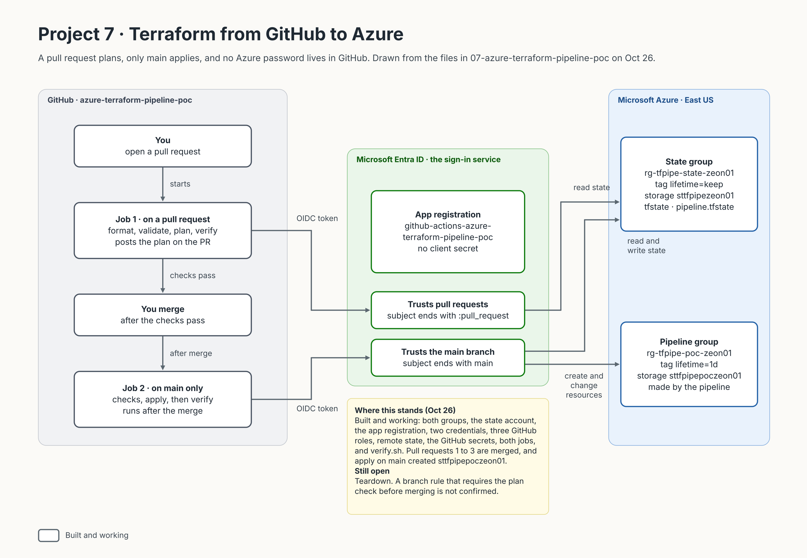

*Reference picture. On that picture, a solid box is built and working. A branch rule that requires the plan check is still open. Teardown is done.*

---

## Project Steps

These steps follow the files in the order each one needs the one before it. Have Terraform 1.15 and the Azure command-line interface (CLI) installed, and sign in with `az login` before the first plan.

Set the subscription for the terminal session without writing it into a file:

```bash
export ARM_SUBSCRIPTION_ID="$(az account show --query id -o tsv)"
```

`ARM` is the prefix the Azure Resource Manager provider uses for its environment variables. Read each plan before you type `yes`.

The bootstrap in this repository already exists in Azure. A fresh clone has no local state file. Do not run `terraform apply` on a clone until you have imported the live resources or destroyed them. A second apply would try to create names that are already taken.

### Step 1: Keep the state file off GitHub

*Declared in `.gitignore`, before `terraform init` or `terraform apply`.*

`terraform init` downloads the providers into `.terraform/`. `terraform apply` writes `terraform.tfstate`. That file holds resource identifiers. Both the state file and `.terraform/` are ignored. `.terraform.lock.hcl` is not ignored.

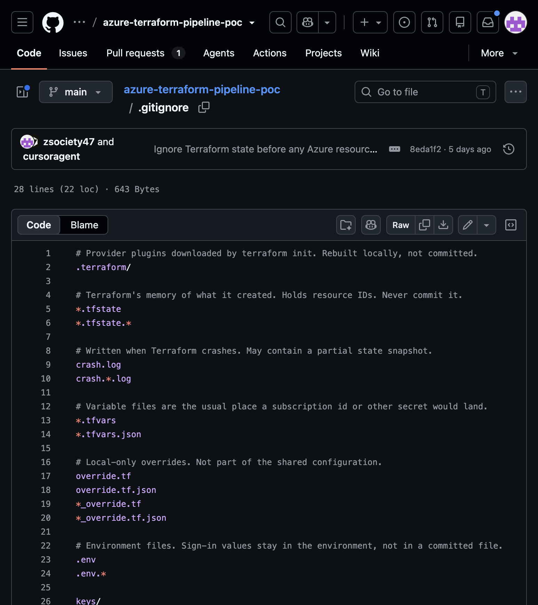

### Step 2: Pin the providers

*Declared in `versions.tf`. Read by `terraform init`.*

The Terraform block requires version 1.15.x, the AzureRM provider `5.10.0`, and the `azuread` provider `3.10.0`. AzureRM manages the two resource groups and the state account. `azuread` manages the app registration and the federated credentials.

```bash
terraform init
```

The last line should be `Terraform has been successfully initialized!`

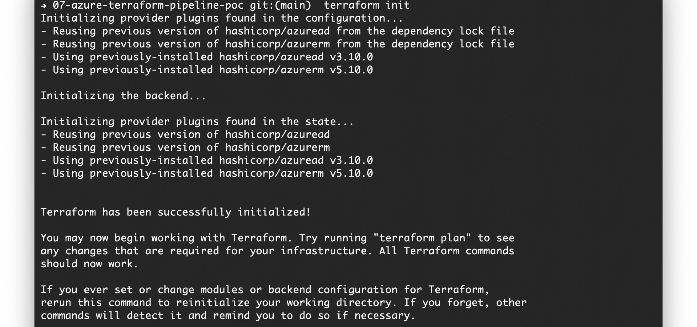

### Step 3: Sign in without storing the subscription id

*Declared in `provider.tf`. Used by every later file.*

The providers use the Azure CLI login already on the machine. There is no `subscription_id` line in the file. `resource_provider_registrations = "none"` means apply does not register Azure resource providers. `storage_use_azuread = true` is required because shared keys are off on the state account. Creating a container is a data action.

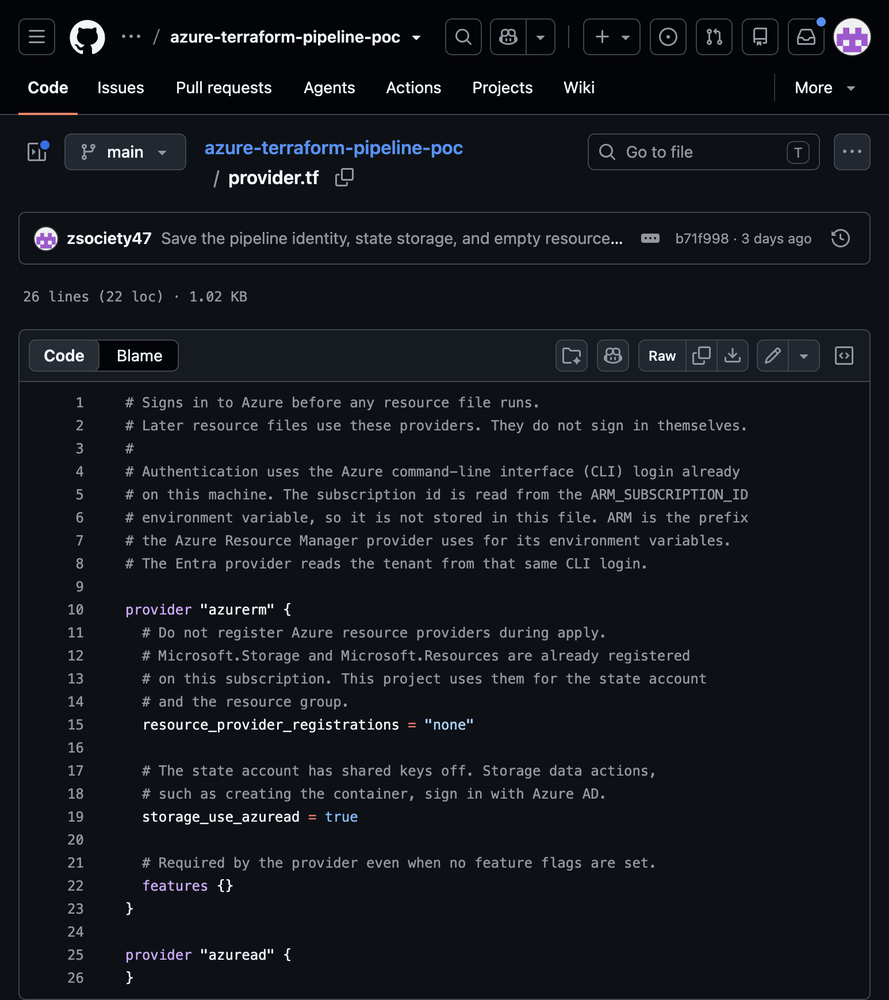

### Step 4: Put the names in one place

*Declared in `variables.tf`. Read by every resource file.*

| Name | Value |
|---|---|
| State resource group | `rg-tfpipe-state-zeon01` |
| Pipeline resource group | `rg-tfpipe-poc-zeon01` |
| Storage account | `sttfpipezeon01` |
| Pipeline storage account | `sttfpipepoczeon01` |
| Container | `tfstate` |
| State blob | `pipeline.tfstate` |
| Region | East US |
| App registration | `github-actions-azure-terraform-pipeline-poc` |
| Repository | `zsociety47/azure-terraform-pipeline-poc` |

The OIDC subjects include the GitHub owner id and repository id. A name-only subject would not match a token from this repository. To run this as yourself, copy `terraform.tfvars.example` and follow [Run this as yourself](#run-this-as-yourself). Do not reuse these ids.

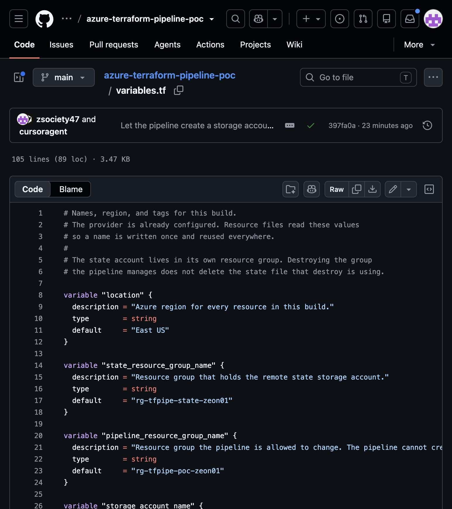

### Step 5: Tag the two groups differently

*Declared in `tags.tf`. Merged into each resource group.*

Both groups get `owner = zeon` and `project = azure-terraform-pipeline-poc`. The state group and the storage account also get `lifetime = keep`, so a nightly delete does not remove the state file. The pipeline group gets `lifetime = 1d`. `created` is set once and then ignored.

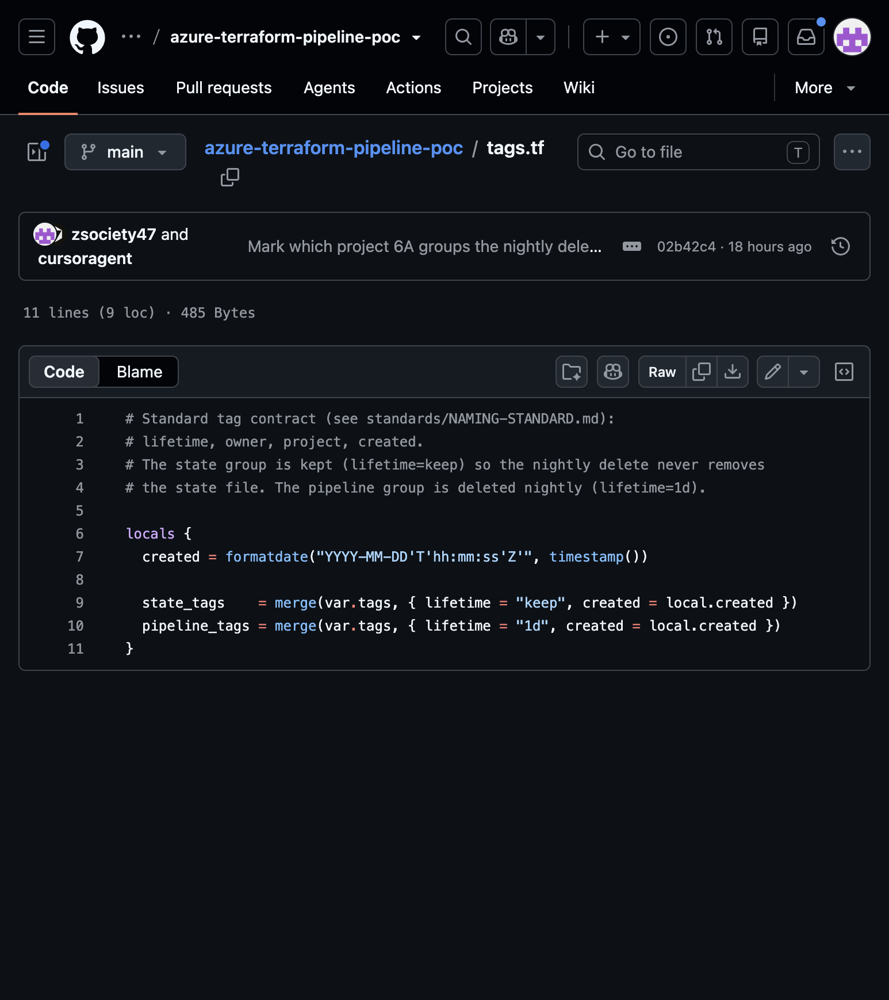

### Step 6: Create the state resource group

*Declared in `state_resource_group.tf`. Created by `terraform apply`.*

`rg-tfpipe-state-zeon01` holds only the state account. The pipeline group is a later file. The first plan, before later files exist, is `1 to add`. Apply created the group in 29 seconds.

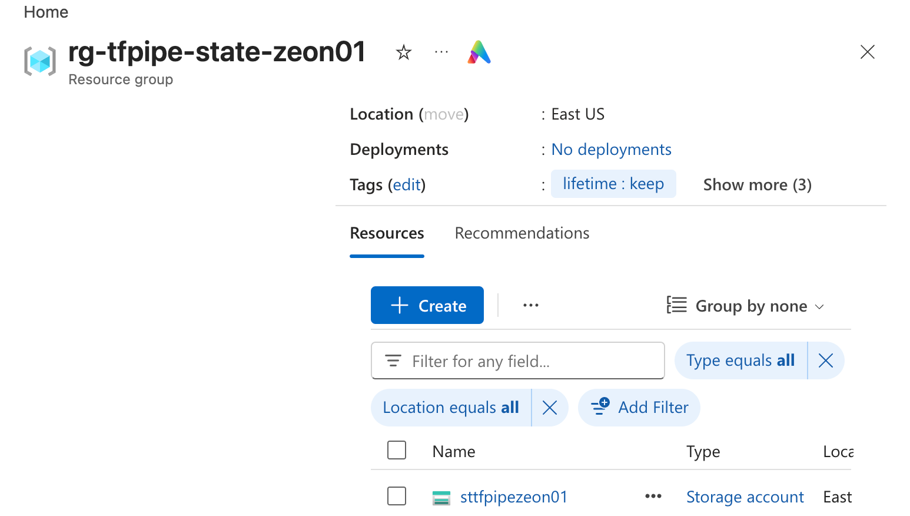

### Step 7: Create the state storage account

*Declared in `storage_account.tf`. Created by `terraform apply`.*

`sttfpipezeon01` is Standard, locally redundant storage (LRS), HTTPS only, Transport Layer Security (TLS) 1.2. Shared keys are off. Anonymous public access is off. Blob versioning is on, with a seven-day delete retention. The plan was `1 to add`. Apply created the account in 27 seconds.

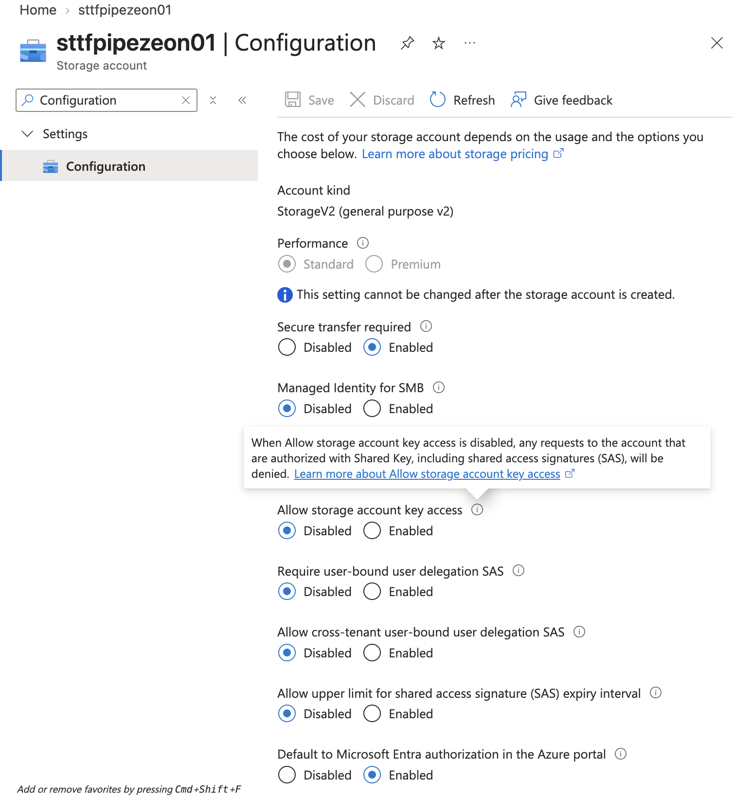

### Step 8: Let the operator write blobs

*Declared in `operator_blob_role.tf`. Created by `terraform apply`.*

The signed-in Azure CLI user gets Storage Blob Data Owner on `sttfpipezeon01`. Shared keys stay off. This role is how the laptop writes the container. `principal_id` is ignored after create, so a GitHub plan does not replace the assignment with the runner's identity. The plan was `1 to add`. Apply created the assignment in 34 seconds.

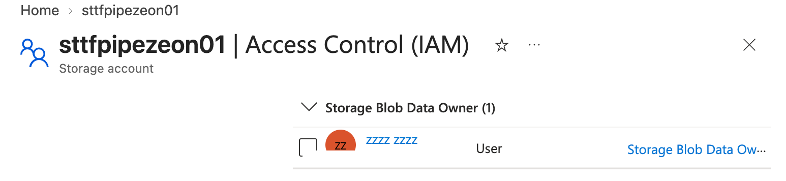

### Step 9: Create the private container

*Declared in `storage_container.tf`. Created by `terraform apply`.*

`tfstate` is private. It depends on the operator role because Terraform cannot see that permission from a value. The plan was `1 to add`. Apply created the container in 12 seconds.

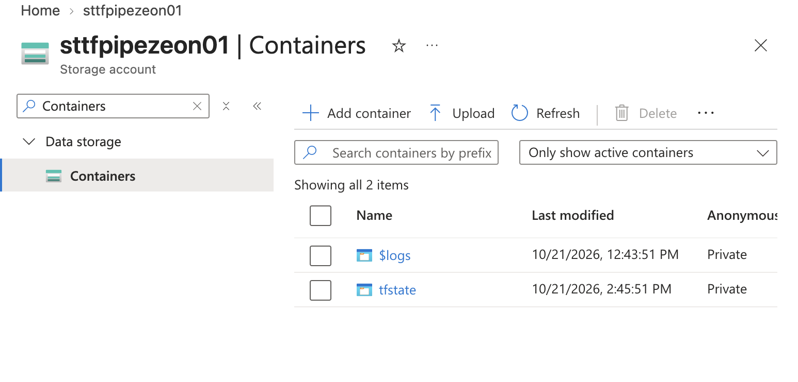

### Step 10: Register the GitHub app

*Declared in `app_registration.tf`. Created by `terraform apply`.*

`github-actions-azure-terraform-pipeline-poc` is an Entra app in this tenant only (`AzureADMyOrg`). There is no client secret. The plan was `1 to add`. Apply created the registration in 1 second.

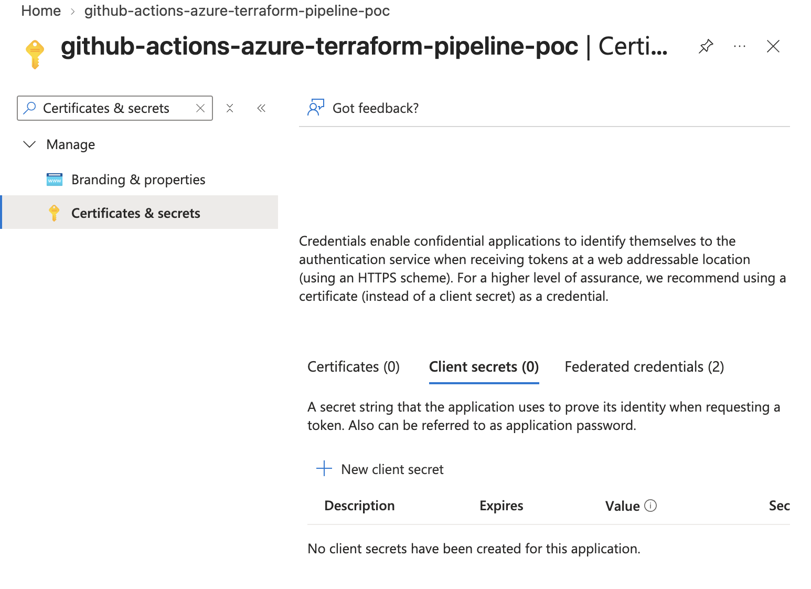

### Step 11: Create the service principal

*Declared in `service_principal.tf`. Created by `terraform apply`.*

A role assignment cannot point at the app registration. It points at this principal. `account_enabled` is true. The plan was `1 to add`. Apply created the principal in 4 seconds.

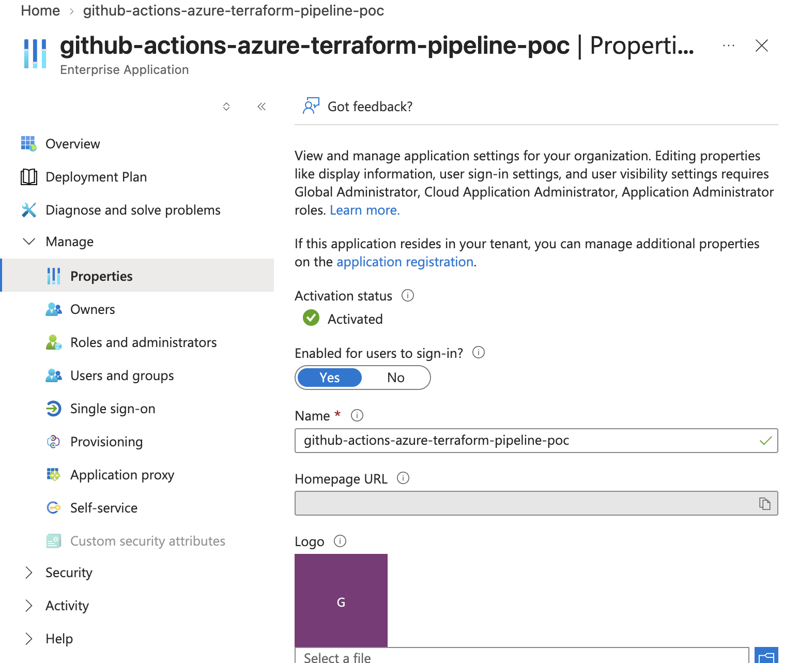

### Step 12: Trust pull requests to plan

*Declared in `pull_request_credential.tf`. Created by `terraform apply`.*

Ask GitHub for this repository's OIDC subject prefix before writing the file. The default is not `repo:owner/name`.

```bash
gh api repos/zsociety47/azure-terraform-pipeline-poc/actions/oidc/customization/sub --jq .sub_claim_prefix
```

This repository's prefix is `repo:zsociety47@122703085/azure-terraform-pipeline-poc@1428385149`. The pull-request subject adds `:pull_request`. Issuer `https://token.actions.githubusercontent.com`. Audience `api://AzureADTokenExchange`. The plan was `1 to add`. Apply created the credential in 8 seconds.

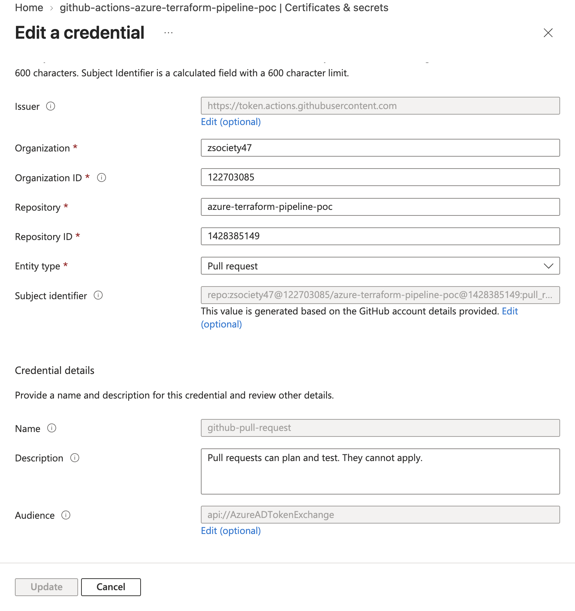

### Step 13: Trust main to apply

*Declared in `main_credential.tf`. Created by `terraform apply`.*

Same issuer and audience. The subject ends in `:ref:refs/heads/main`. A pull request token will not match this credential. The plan was `1 to add`. Apply created the credential in 10 seconds.

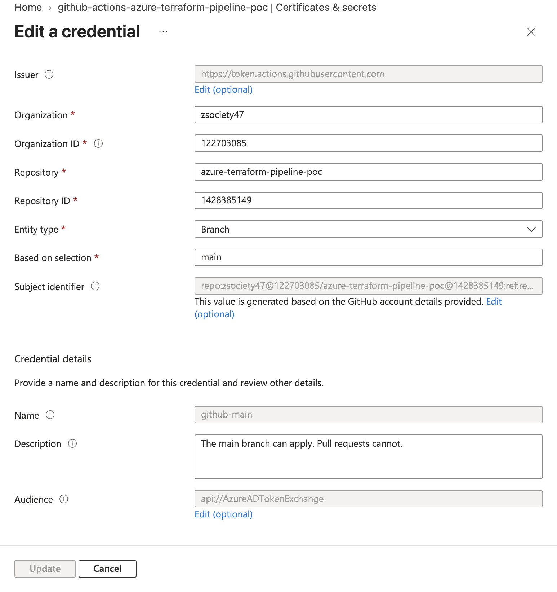

### Step 14: Let GitHub read and write state blobs

*Declared in `github_blob_role.tf`. Created by `terraform apply`.*

The GitHub principal gets Storage Blob Data Contributor on `sttfpipezeon01`. That is a data-plane role. It cannot create resource groups. The plan was `1 to add`. Apply created the assignment in 32 seconds.

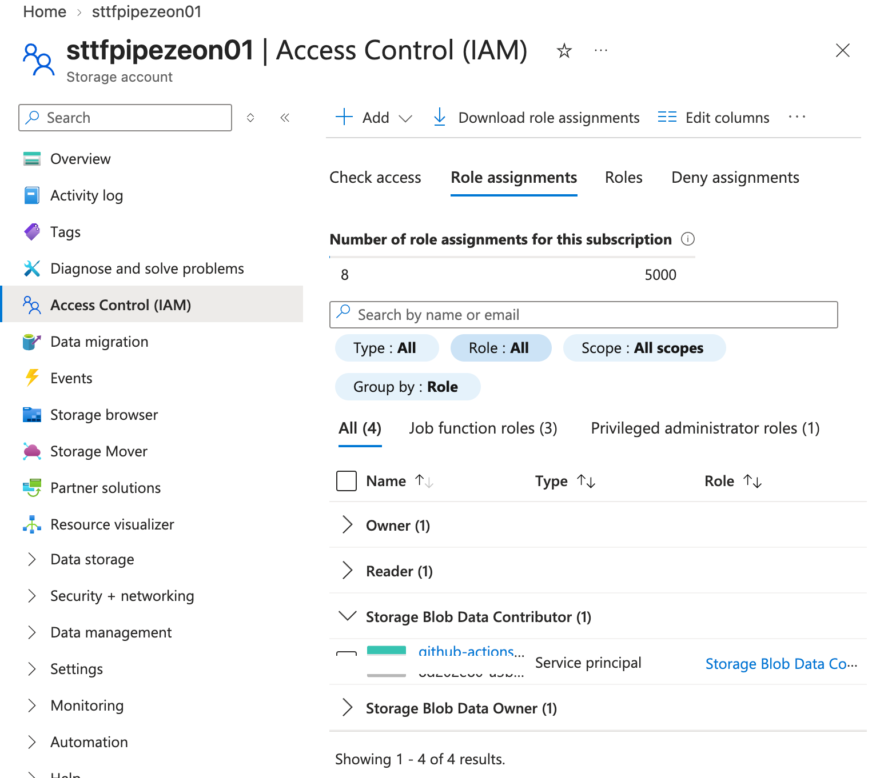

### Step 15: Create the empty pipeline group

*Declared in `pipeline_resource_group.tf`. Created by `terraform apply`.*

The group started empty so a role could be scoped to it. A role cannot be scoped to a group that does not exist, and the GitHub principal is not allowed to create groups. The plan was `1 to add`. Apply created the group in 26 seconds. Step 16 then granted Contributor on this group. Apply on `main` later created `sttfpipepoczeon01` here.

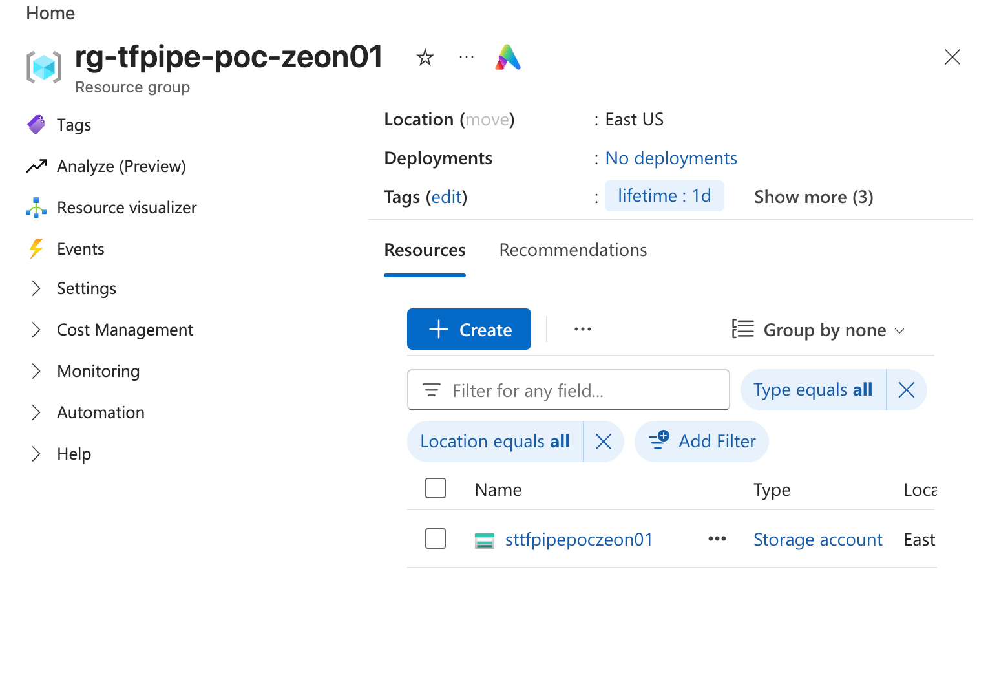

### Step 16: Let GitHub change only the pipeline group

*Declared in `github_pipeline_role.tf`. Created by `terraform apply`.*

The GitHub principal gets Contributor on `rg-tfpipe-poc-zeon01`. Contributor can create, change, and delete resources in that group. The scope is the group, not the subscription, so this role cannot create other resource groups. This file needs the empty group from step 15 and the service principal from step 11. The later workflow files need this assignment before they can apply. The plan was `1 to add, 3 to change`. Apply added the role and updated the tags. The only role on this group is Contributor, and it is a service principal.

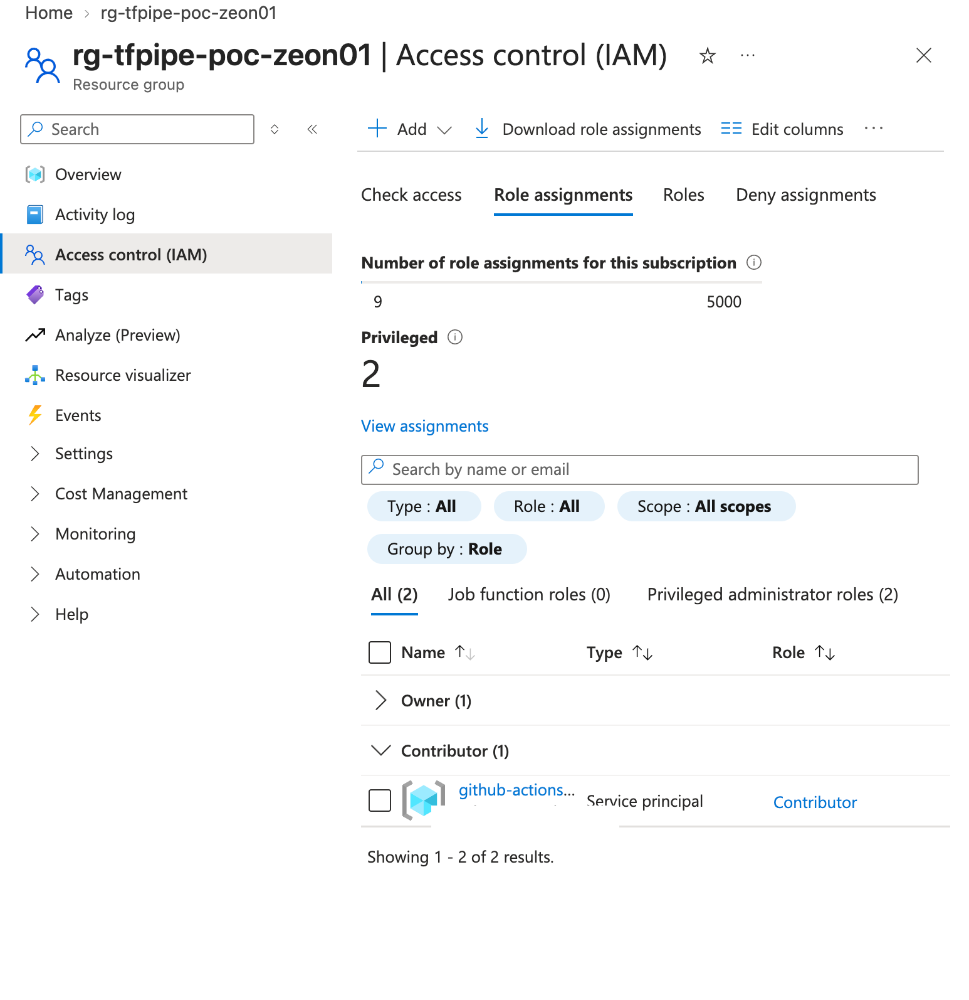

### Step 17: Store state in Azure

*Declared in `backend.tf`. Copied by `terraform init -migrate-state`.*

`st` is Microsoft's abbreviation for a storage account. `tfpipe` is this project. `zeon01` is the owner. So `sttfpipezeon01` is the storage account that holds Terraform state. The container is `tfstate`. The blob is `pipeline.tfstate`.

This block cannot use variables. The names are the same literals as in `variables.tf`. `use_azuread_auth = true` is required because shared keys are off. The subscription id is not in the file. `terraform init -migrate-state` copied the local state into that blob. The container now lists `pipeline.tfstate`.

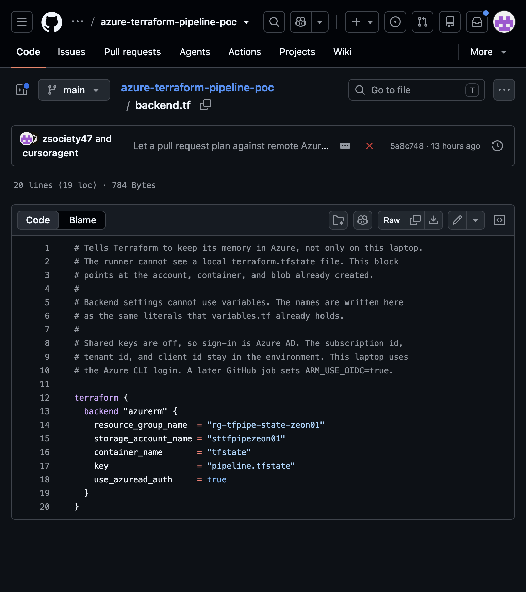

### Step 18: Save the three GitHub secrets

*Set with `gh secret set`. No file in this repository holds the values.*

The workflow will need the app's client id, the tenant id, and the subscription id. They are piped from Azure into GitHub so they do not print. GitHub shows the names after you save them, not the values.

```bash
az ad app list \
  --display-name github-actions-azure-terraform-pipeline-poc \
  --query "[0].appId" -o tsv \
  | gh secret set AZURE_CLIENT_ID --repo zsociety47/azure-terraform-pipeline-poc

az account show --query tenantId -o tsv \
  | gh secret set AZURE_TENANT_ID --repo zsociety47/azure-terraform-pipeline-poc

az account show --query id -o tsv \
  | gh secret set AZURE_SUBSCRIPTION_ID --repo zsociety47/azure-terraform-pipeline-poc
```

`gh secret list` then shows three names: `AZURE_CLIENT_ID`, `AZURE_TENANT_ID`, `AZURE_SUBSCRIPTION_ID`.

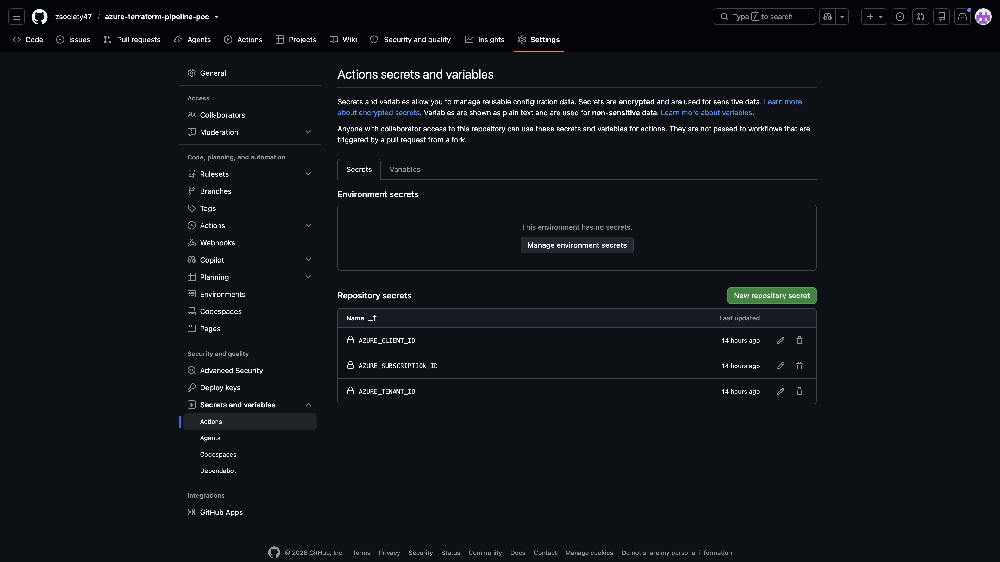

### Step 19: Plan on a pull request

*Declared in `.github/workflows/plan.yml`. Runs when a pull request targets `main`.*

The job checks format, initializes against `sttfpipezeon01`, validates, runs `terraform plan`, and runs `scripts/verify.sh`. It does not apply. A failed verify fails the job. Sign-in is OpenID Connect, the same three secrets as step 18. There is no GitHub environment on this job. An environment would change the token subject, and Azure would not match `github-pull-request`.

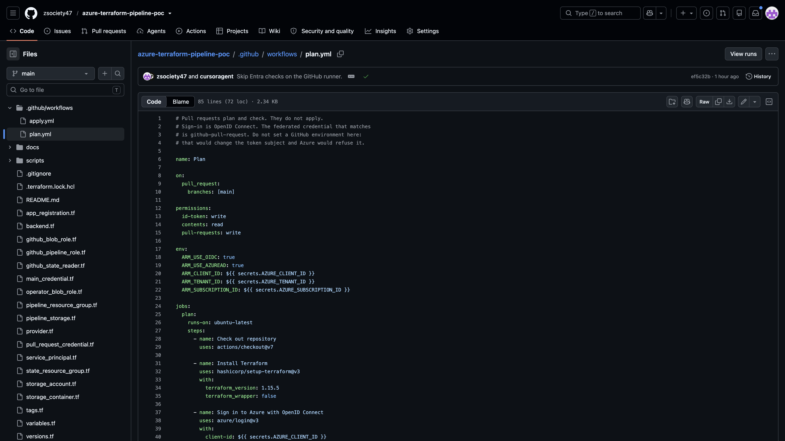

The plan comment strips subscription ids and other UUID-shaped identifiers before it is posted.

GitHub runs this workflow from the pull-request branch. The first plan is that pull request, not a file that already has to live on `main`.

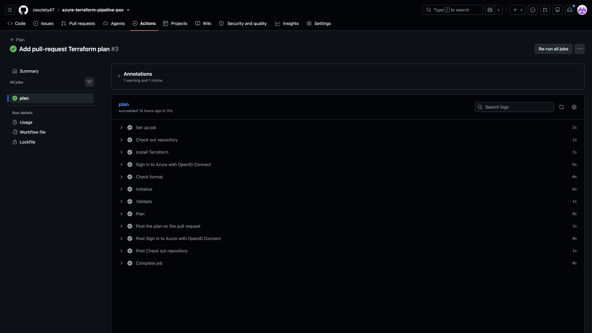

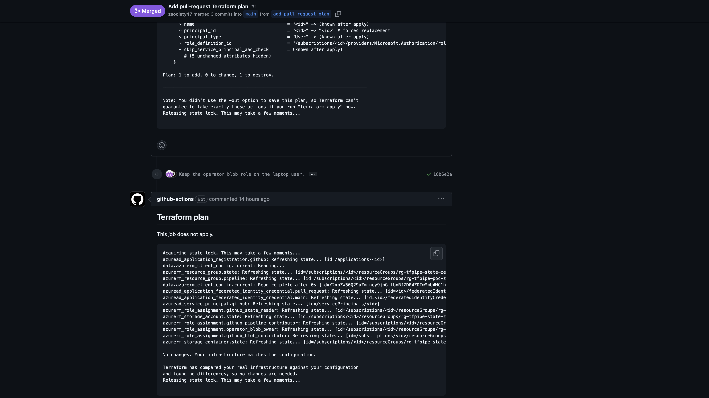

The first run signed in, initialized, and validated. Plan then failed with `403` on `resourceGroups/read` for `rg-tfpipe-state-zeon01`. Step 20 is the Reader role that fixes that. The next run posted a redacted plan on [pull request 1](https://github.com/zsociety47/azure-terraform-pipeline-poc/pull/1). That plan wanted to replace `operator_blob_owner`. Step 8 now ignores `principal_id` so the assignment stays on the operator. Shared keys stay off.

### Step 20: Let GitHub read the state group

*Declared in `github_state_reader.tf`. Created by `terraform apply`.*

Plan refreshes every resource in state, including the state group. The GitHub principal already had Storage Blob Data Contributor on `sttfpipezeon01` and Contributor on the pipeline group. Neither of those lets it read `rg-tfpipe-state-zeon01`. Reader on that group can see it and cannot change it. Contributor stays on the pipeline group only. The plan was `1 to add`. Apply added the assignment. The only role on the state group is Reader, and it is a service principal.

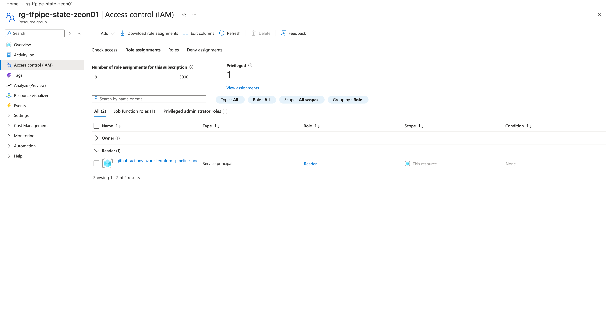

### Step 21: Apply on main

*Declared in `.github/workflows/apply.yml`. Runs when someone pushes to `main`.*

The job repeats format, init, and validate, then runs `terraform apply`, then `scripts/verify.sh`. A failed verify fails the job. Pull requests cannot start this file. Sign-in is OpenID Connect. There is no GitHub environment on this job. An environment would change the token subject, and Azure would not match `github-main`. `concurrency` keeps two applies from writing state at the same time.

The first push that adds this file to `main` runs apply.

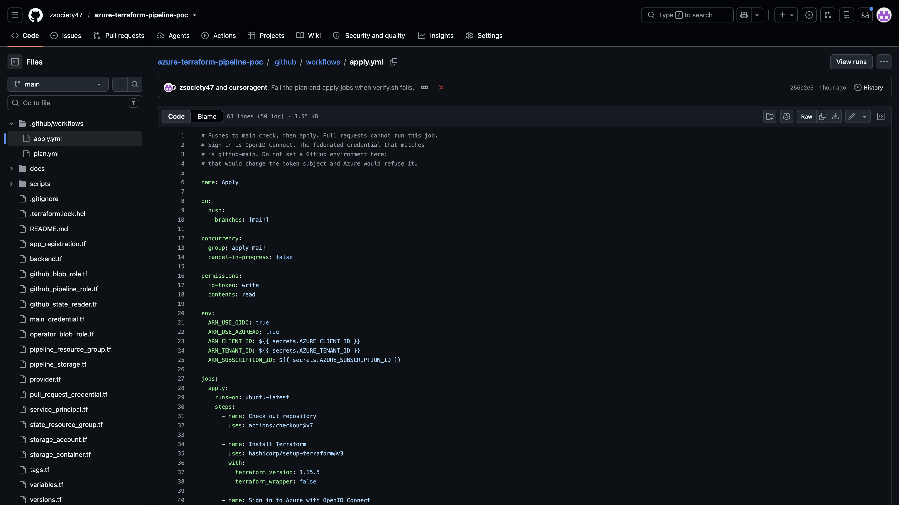

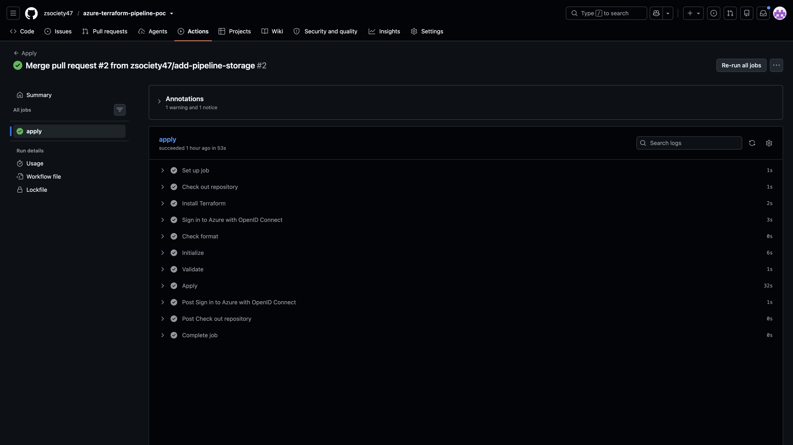

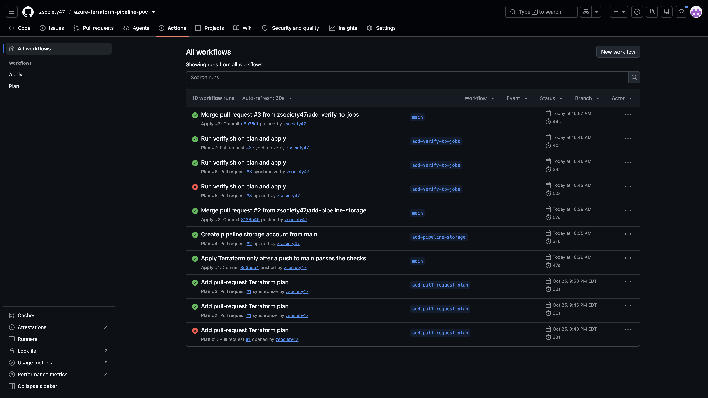

### Step 22: Verify the bootstrap

*Declared in `scripts/verify.sh`. Run from this folder after `az login`.*

The script reads Azure. It does not create or delete anything. It checks both groups, the four tags, shared keys off, the state blob, the app registration, both federated credentials, and the GitHub roles. It does not print subscription ids.

All twelve checks passed on the laptop after Apply created `sttfpipepoczeon01`. The plan and apply jobs run this script. Checks 7 and 8 need Microsoft Entra ID read access, which the GitHub principal does not have, so those two are skipped on the runner. A failed Azure check still fails the job.

```bash
./scripts/verify.sh
```

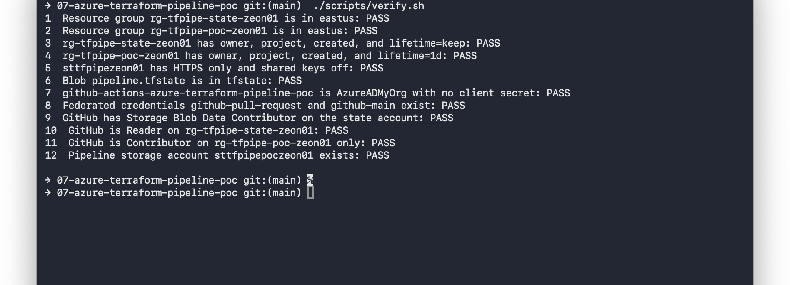

### Step 23: The resource the pipeline creates

*Declared in `pipeline_storage.tf`. Created by the apply job on `main`, not by this laptop.*

`sttfpipepoczeon01` is a storage account in `rg-tfpipe-poc-zeon01`. `st` is storage. `tfpipe` is this project. `poc` is proof of concept. `zeon01` is the owner. Shared keys are off. It is not the state account. [Pull request 2](https://github.com/zsociety47/azure-terraform-pipeline-poc/pull/2) planned `1 to add`. Apply on `main` added it: https://github.com/zsociety47/azure-terraform-pipeline-poc/actions/runs/40341623802

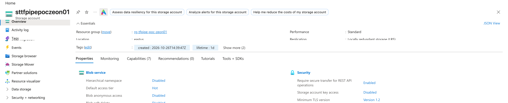

### Step 24: Remove it

*Run `terraform destroy` only after you type a confirmation. The nightly sweep cannot delete the Entra app or the federated credentials.*

One `terraform destroy` of this configuration is the teardown. Terraform deletes in reverse dependency order. Destroy the pipeline group first only if you want to keep the remote state file. Destroying `rg-tfpipe-state-zeon01` deletes the state account. After that account is gone, Terraform cannot write state back, so the Entra app may need a second destroy from the local recovery file. Do not use `az group delete` as a shortcut: the Entra app and federated credentials live outside the groups.

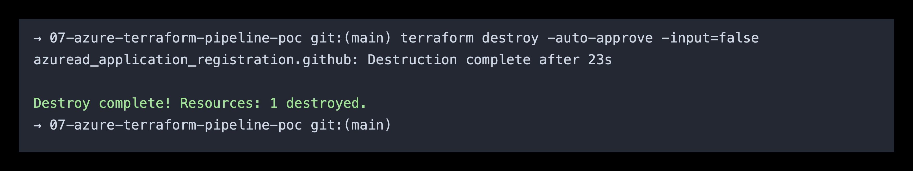

---

## Automated setup

You need Terraform 1.15.x, the Azure CLI, and a current `az login`. Run these from the repository root, in this order. Each group is one action.

This bootstrap already exists. Use the checks to read Azure. Use apply only after a destroy, or on a machine that already has the local state file.

### Run this as yourself

The names, tags, and GitHub ids in `variables.tf` are this proof of concept. They are not yours. Fork or clone the repository, then copy `terraform.tfvars.example` to `terraform.tfvars` (that file is gitignored). Change:

- every resource name that ends in `zeon01` (put your owner word there; storage account names are lowercase letters and digits only)
- `github_repository` to `YOUR_OWNER/YOUR_REPO`
- `tags.owner`
- the two OpenID Connect (OIDC) subjects. Do not copy the numbers from `variables.tf`. Ask GitHub for your ids:

```bash
gh api repos/YOUR_OWNER/YOUR_REPO --jq '"owner_id=\(.owner.id)\nrepository_id=\(.id)"'
```

Then set:

```text
repo:YOUR_OWNER@OWNER_ID/YOUR_REPO@REPO_ID:pull_request
repo:YOUR_OWNER@OWNER_ID/YOUR_REPO@REPO_ID:ref:refs/heads/main
```

In the commands below, replace `zsociety47/azure-terraform-pipeline-poc` and the `zeon01` names with the values you put in `terraform.tfvars`. You need an Azure subscription you can create resource groups in, and a GitHub repository you can put secrets on. `az login` and `gh auth login` first. The pipeline still cannot create its own resource group: create `pipeline_resource_group_name` on the laptop, then let GitHub apply into it.

### Sign in for this terminal

The subscription stays in this terminal session. Do not print it.

```bash
export ARM_SUBSCRIPTION_ID="$(az account show --query id -o tsv)"
```

You should see no output.

### Download the providers

This is step 2. It runs once per machine.

```bash
terraform init
```

The last line should be `Terraform has been successfully initialized!`

After `backend.tf` is added, migrate the local state. That is step 17.

```bash
terraform init -migrate-state
```

Type `yes` only if Terraform asks to copy the existing state to the new backend. A later list of the `tfstate` container should include `pipeline.tfstate`.

### Save the GitHub secrets

This is step 18. The values are piped and must not print.

```bash
az ad app list \
  --display-name github-actions-azure-terraform-pipeline-poc \
  --query "[0].appId" -o tsv \
  | gh secret set AZURE_CLIENT_ID --repo zsociety47/azure-terraform-pipeline-poc

az account show --query tenantId -o tsv \
  | gh secret set AZURE_TENANT_ID --repo zsociety47/azure-terraform-pipeline-poc

az account show --query id -o tsv \
  | gh secret set AZURE_SUBSCRIPTION_ID --repo zsociety47/azure-terraform-pipeline-poc
```

```bash
gh secret list --repo zsociety47/azure-terraform-pipeline-poc
```

A pass is those three names. No values.

### Read the plan

```bash
terraform plan
```

After the Contributor role and the tag updates, a later plan should show no changes. A line that contains `/subscriptions/` is not a screenshot.

### Confirm the bootstrap

These commands create nothing. Crop any line that contains `/subscriptions/`.

```bash
az group exists --name rg-tfpipe-state-zeon01
az group exists --name rg-tfpipe-poc-zeon01
```

Both should print `true`.

```bash
az storage account show \
  --name sttfpipezeon01 \
  --resource-group rg-tfpipe-state-zeon01 \
  --query "{name:name, httpsOnly:enableHttpsTrafficOnly, sharedKeys:allowSharedKeyAccess, oauthDefault:defaultToOAuthAuthentication}" \
  -o json
```

A pass looks like `sttfpipezeon01`, `httpsOnly` true, `sharedKeys` false, `oauthDefault` true.

```bash
az storage blob list \
  --account-name sttfpipezeon01 \
  --container-name tfstate \
  --auth-mode login \
  --query "[].name" \
  -o tsv
```

A pass looks like `pipeline.tfstate`.

```bash
az ad app list \
  --display-name github-actions-azure-terraform-pipeline-poc \
  --query "[].{name:displayName, audience:signInAudience}" \
  -o json
```

A pass looks like the display name and audience `AzureADMyOrg`.

```bash
az role assignment list \
  --resource-group rg-tfpipe-poc-zeon01 \
  --query "[].{role:roleDefinitionName, kind:principalType}" \
  -o table
```

A pass looks like one row: `Contributor`, `ServicePrincipal`.

### Remove it

This is step 24. Do not run it unless you mean to delete the state account, both groups, the role assignments, and the Entra objects Terraform still tracks. After state is remote, destroy still reads that same blob. Destroying `rg-tfpipe-state-zeon01` last is what removes the account the backend is using. When that account goes away mid-destroy, Terraform writes `errored.tfstate` locally. Finish the remaining Entra objects from that file. Do not use `az group delete`.

```bash
terraform destroy
```

Type the full word `yes` only after you read the destroy plan.

### Prove it in the portal

| Check | Where to click | A pass looks like |
|---|---|---|
| 1. The state group exists in East US | **Resource groups**, `rg-tfpipe-state-zeon01` | Region East US. Tag `lifetime` is `keep` |
| 2. The pipeline group exists | **Resource groups**, `rg-tfpipe-poc-zeon01` | Contains `sttfpipepoczeon01`. Tag `lifetime` is `1d` |
| 3. Shared keys are off | `sttfpipezeon01`, **Configuration** | Allow storage account key access is off |
| 4. The container is private | `sttfpipezeon01`, **Containers**, `tfstate` | Access is private |
| 5. The app has no client secret | **Microsoft Entra ID**, **App registrations**, `github-actions-azure-terraform-pipeline-poc` | Certificates and secrets lists no secret |
| 6. Two federated credentials exist | That app, **Certificates & secrets**, **Federated credentials** | `github-pull-request` and `github-main` |
| 7. GitHub can write blobs | `sttfpipezeon01`, **Access control**, **Role assignments** | Storage Blob Data Contributor for the GitHub app |
| 8. GitHub is Contributor on the pipeline group only | `rg-tfpipe-poc-zeon01`, **Access control** | One Contributor row, service principal |
| 9. Three secret names exist | This repository, **Settings**, **Secrets and variables**, **Actions** | `AZURE_CLIENT_ID`, `AZURE_TENANT_ID`, `AZURE_SUBSCRIPTION_ID`. No values on screen |

---

## Architecture

The picture above is the reference. The Mermaid below is the live map.

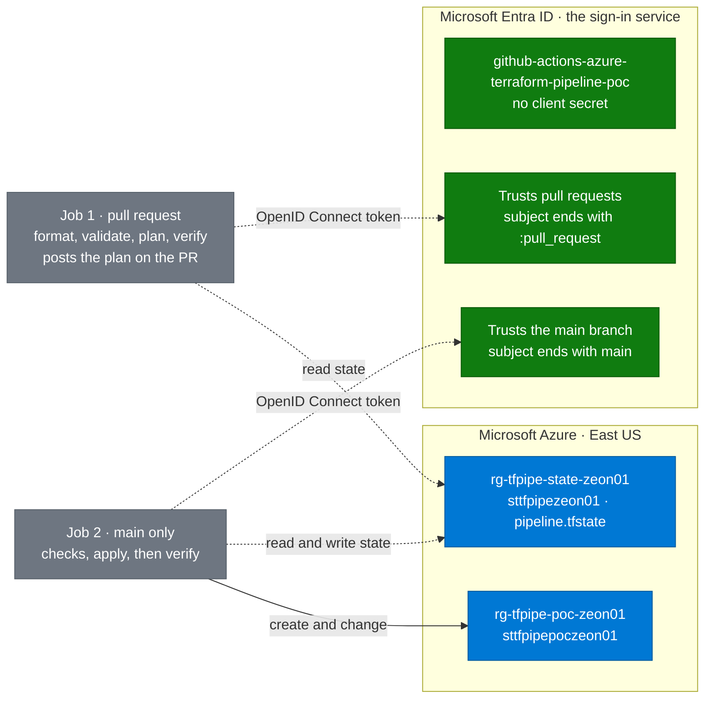

**How to read this diagram**

- **Solid arrows** are apply creating resources in the pipeline group. **Dashed arrows** are the deploy path: an OpenID Connect (OIDC) token, then state access.
- **Gray:** the two GitHub jobs. **Green:** the Entra app and the two federated credentials. **Blue:** the two resource groups.
- A pull request can read state and plan. Only `main` can write state and create `sttfpipepoczeon01`.
- The state group is separate so destroying `rg-tfpipe-poc-zeon01` cannot delete the state file that destroy is using.

*Diagram follows the [shared diagram standard](https://github.com/zsociety47/cloud-projects/blob/main/standards/DIAGRAM-STANDARD.md).*

---

## Hypothesis

A pull request can plan and test a Terraform change, and only the `main` branch can apply it, without storing an Azure password in GitHub, if state lives in Azure Storage instead of only on the laptop.

## Success criteria

| # | Criterion | How it is checked | Result |
|---|-----------|-------------------|--------|
| 1 | `rg-tfpipe-state-zeon01` exists | `az group exists --name rg-tfpipe-state-zeon01` prints `true` | ✅ [confirm the bootstrap](#confirm-the-bootstrap) |
| 2 | `rg-tfpipe-poc-zeon01` exists | `az group exists --name rg-tfpipe-poc-zeon01` prints `true` | ✅ `scripts/verify.sh` check 2 |
| 3 | `sttfpipezeon01` has shared keys off and HTTPS only | `az storage account show` returns `sharedKeys` false and `httpsOnly` true | ✅ [confirm the bootstrap](#confirm-the-bootstrap) |
| 4 | The app registration exists with no client secret | `az ad app list` returns `github-actions-azure-terraform-pipeline-poc` and `AzureADMyOrg` | ✅ [confirm the bootstrap](#confirm-the-bootstrap) |
| 5 | Two federated credentials match this repository's OIDC subjects | Entra lists `github-pull-request` and `github-main` | ✅ `scripts/verify.sh` check 8 |
| 6 | GitHub has Storage Blob Data Contributor on the state account | Role assignment on `sttfpipezeon01` | ✅ `scripts/verify.sh` check 9 |
| 7 | GitHub is Contributor on `rg-tfpipe-poc-zeon01` only | `az role assignment list` returns one row: `Contributor`, `ServicePrincipal` | ✅ [confirm the bootstrap](#confirm-the-bootstrap) |
| 8 | A pull request posts `terraform plan` and does not apply | GitHub Actions run on a pull request | ✅ [pull request 1](https://github.com/zsociety47/azure-terraform-pipeline-poc/pull/1) |
| 9 | A push to `main` applies only after the checks pass | GitHub Actions run on `main` | ✅ [Apply run](https://github.com/zsociety47/azure-terraform-pipeline-poc/actions/runs/40339604773) |
| 10 | Teardown removes the groups, the account, and the Entra app | `terraform destroy`, then the app is gone | ✅ [step 24](#step-24-remove-it) |
| 11 | Remote state is `pipeline.tfstate` in the `tfstate` container | `az storage blob list` prints `pipeline.tfstate` | ✅ [confirm the bootstrap](#confirm-the-bootstrap) |

Criteria 1 through 9 and 11 were checked on 25–26 October 2026. Check 12 of `scripts/verify.sh` passed after Apply created `sttfpipepoczeon01`. Criterion 10: both groups `az group exists` printed `false`, and `az ad app list` for `github-actions-azure-terraform-pipeline-poc` was empty, on 26 October 2026.

## What's in this repository

```
.
├── .gitignore               State, .env, and provider plugins stay off GitHub
├── versions.tf              Terraform 1.15, AzureRM 5.10.0, azuread 3.10.0
├── provider.tf              Azure CLI sign-in. Azure AD for storage data actions
├── variables.tf             Names, subjects, and base tags
├── tags.tf                  lifetime keep on state, 1d on the pipeline group
├── state_resource_group.tf  rg-tfpipe-state-zeon01
├── storage_account.tf       sttfpipezeon01, shared keys off
├── operator_blob_role.tf    Storage Blob Data Owner for the operator
├── storage_container.tf     private tfstate container
├── app_registration.tf      github-actions-azure-terraform-pipeline-poc
├── service_principal.tf     Identity a role can point at
├── pull_request_credential.tf  Trusts a pull-request OIDC token
├── main_credential.tf       Trusts a main-branch OIDC token
├── github_blob_role.tf      Storage Blob Data Contributor for GitHub
├── pipeline_resource_group.tf  rg-tfpipe-poc-zeon01
├── github_pipeline_role.tf  Contributor for GitHub on that group only
├── github_state_reader.tf   Reader for GitHub on the state group only
├── pipeline_storage.tf      sttfpipepoczeon01, created by the pipeline
├── backend.tf               Remote state in sttfpipezeon01 / tfstate
├── .github/workflows/plan.yml   Pull request: format, validate, plan. No apply
├── .github/workflows/apply.yml  main: those checks, then apply
├── scripts/verify.sh            Live Azure checks. Does not apply
├── .terraform.lock.hcl      Exact provider builds selected by terraform init
└── docs/
    └── architecture/
        ├── architecture.png Design picture from the Claude canvas
        ├── architecture.pdf Same picture, print copy
        └── README-snippet.md  Notes for the two diagrams
```

## Security choices

- **No client secret.** GitHub signs in with OpenID Connect. The app registration has none.
- **The OIDC subject includes numeric ids.** A name-only subject does not match a token from this repository.
- **Pull requests and `main` are different credentials.** A pull-request token cannot satisfy the main subject.
- **Shared keys are off.** Blob access uses Azure role-based access control.
- **State lives in its own group.** Deleting `rg-tfpipe-poc-zeon01` does not delete `pipeline.tfstate`.
- **The GitHub blob role cannot create groups.** Storage Blob Data Contributor is data-plane only.
- **Contributor is scoped to one group.** The GitHub principal can change `rg-tfpipe-poc-zeon01`. It cannot create other resource groups.
- **State lives in Azure.** `backend.tf` points at `sttfpipezeon01`. After migrate, the blob is `pipeline.tfstate`. The leftover local `terraform.tfstate` is empty and still gitignored.
- **The subscription id is an environment variable.** `provider.tf` does not contain it.

## Cost

A resource group, an app registration, and two role assignments have no hourly charge. `sttfpipezeon01` is Standard locally redundant storage. Blob versioning keeps older copies of the state file. Expect cents per month while the account exists. The pipeline group is tagged `lifetime = 1d`. The state group is tagged `lifetime = keep` on purpose. Prices were checked in October 2026.

## Going further

- Redraw the design picture so it matches the live files.
- Later Azure projects do not copy this repository. They call the shared modules in [`cloud-projects/terraform/azure/modules`](https://github.com/zsociety47/cloud-projects/tree/main/terraform/azure/modules) and the reusable Azure Plan / Apply jobs. This repository stays the walkthrough of building the pipeline by hand.

---

## Technical findings

*For engineers: what actually happened while building this, including the errors.*

- **`East US` is stored as `eastus`.** `variables.tf` sets `location = "East US"`. The plan shows `location = "eastus"`. Those are the same region.
- **Shared keys off blocks container create until the provider uses Azure AD.** The first container plan needed `storage_use_azuread = true` on the AzureRM provider. Creating a container is a data action.
- **The OIDC subject is not `repo:owner/name`.** GitHub sent `repo:zsociety47@122703085/azure-terraform-pipeline-poc@1428385149`. A name-only federated credential would fail with no matching record.
- **The pipeline cannot create the group it deploys into.** The GitHub principal has no permission to create resource groups. `rg-tfpipe-poc-zeon01` was created on the laptop so a later role can be scoped to it.
- **State cannot live in the group the pipeline destroys.** `rg-tfpipe-state-zeon01` holds the account. Destroying the pipeline group leaves the state file in place.
- **One destroy of the whole config deleted both groups, then failed to save state.** The state account was already gone, so Terraform returned 404 ResourceNotFound, wrote `errored.tfstate`, and left `azuread_application_registration.github`. A second destroy from that local file removed the Entra app. `az group delete` was not used.
- **A plan prints full resource identifiers.** Refresh and role lines include the subscription id. Those strings are not pasted here.
- **A tag-only plan was not applied.** After `tags.tf` was added, plan was `0 to add, 3 to change, 0 to destroy` on the two groups and the storage account. That apply has not been run.
